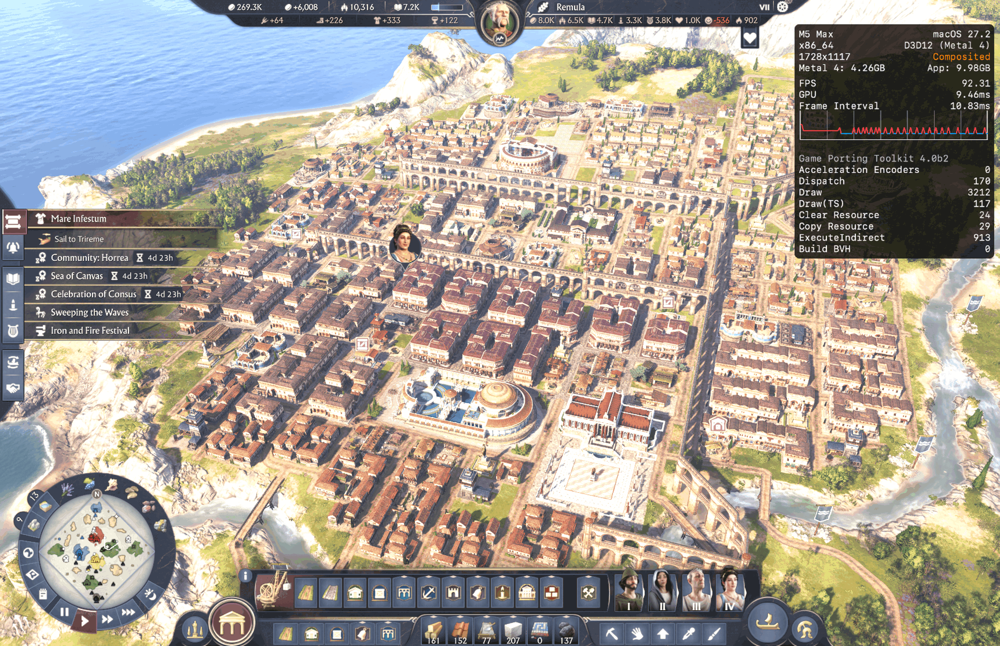

# Anno 117 through Steam + notproton (fastest setup)

This is the same shim fix as the main README, run through **Steam with the
notproton compatibility tool** instead of a CrossOver bottle.
On an M5 Max it is about 3x faster, mainly because the Rosetta tool ships **Game Porting Toolkit
(D3DMetal) 4.0b2**.



## Measured result

| | |
|---|---|
| Machine | Apple M5 Max, macOS 27.2 |
| Tool | "CrossOver 2026 10 06-ARM64 - Rosetta" (build 27.0.0.41069) |
| Translation layer | D3D12 to Metal 4, Game Porting Toolkit **4.0b2** |
| Settings | Quality High, DLSS option set to Quality |
| Render resolution | 1728x1117 |
| FPS | ~100 in play; **92.31** in the screenshot |
| GPU time / frame interval | 9.46 ms / 10.83 ms |
| Memory | Metal 4.26 GB, app 9.98 GB |
| Per-frame work | Draw 3212, Dispatch 170, ExecuteIndirect 913 |

Scene: a large late-game city, a heavy case. Earlier CrossOver-bottle numbers on D3DMetal 4.0b1
were ~30 FPS (High) and ~50 FPS (Medium); 3.0 was not benchmarked.

## Setup

The prefix below is `~/Library/Application Support/Steam/steamapps/compatdata/3274580`
(3274580 is Anno 117's Steam app id).

### 1. Install the shim
In the game's `Bin/Win64` folder
(`~/Library/Application Support/Steam/steamapps/common/Anno 117 - Pax Romana/Bin/Win64`):

```
cp amd_ags_x64.dll amd_ags_orig.dll      # stock AMD DLL -> orig (skip if it is already the shim!)
cp /path/to/this/repo/amd_ags_x64.dll amd_ags_x64.dll
```

The shim is ~113 KB, the stock DLL ~167 KB. Check that the two files differ.

### 2. Add the DLL overrides to the prefix
With Steam and Wine closed, append to `compatdata/3274580/pfx/user.reg`:

```
[Software\\Wine\\AppDefaults\\Anno117.exe\\DllOverrides] 1772426989
"amd_ags_orig"="native"
"amd_ags_x64"="native,builtin"
```

### 3. Use the Rosetta tool, not FEX
In Steam: Anno 117, Properties, Compatibility, force a tool, then pick
**CrossOver 2026 10 06-ARM64 - Rosetta**.

The FEX (ARM64) flavor discards `CX_GRAPHICS_BACKEND=d3dmetal`, so there is no D3D12 adapter and the
game log says `Global Startup failed with error code -1213 (Failed to retrieve the DXGI adapter.)`.
The process stays alive but never opens a window. Do not hand-edit a tool's `flavor` file;
notproton rejects it with "selected compatibility tool is unavailable".

### 4. Rebuild the prefix
Steam offers **Backup & Rebuild Prefix** after you switch tools (saves are kept). If it fails with
"game is running", kill leftover Wine processes (`winedevice.exe`, `wineserver`) and retry.
Afterwards confirm the overrides from step 2 are still in `user.reg`.

### 5. Force D3DMetal and show the FPS HUD
Create `~/Library/Application Support/notproton/defaults-rosetta`:

```
CX_GRAPHICS_BACKEND=d3dmetal
ROSETTA_ADVERTISE_AVX=1
MTL_HUD_ENABLED=1
```

`MTL_HUD_ENABLED=1` is Apple's Metal HUD (FPS, GPU time, frame interval, GPTK version). Remove the
line to hide it. These defaults apply to every game that uses the Rosetta tool.

### 6. Launch
Click through the harmless "outdated graphics driver" popup.

## Which D3DMetal is loaded?
The runner ships `lib/apple_gptk` (**4.0b2**) and `lib/apple_gptk3` (3.0). With the setup above the
game maps `apple_gptk`, and the HUD prints "Game Porting Toolkit 4.0b2". Check with:

```
lsof -p <Anno117 pid> | grep D3DMetal
```

## Troubleshooting

| Symptom | Cause / fix |
|---|---|
| Process runs, no window, log shows `-1213` | FEX tool or D3DMetal not enabled: steps 3 and 5 |
| Process runs, no window, no `-1213` | A Steam update replaced the shim: step 1 |
| "prefix ntdll is aa64 ... rebuild the prefix" | You switched tool flavor: step 4 |
| Rebuild fails, "game is running" | Kill stray `winedevice.exe` / `wineserver` |
| Overrides missing after rebuild | Redo step 2 |

Game logs: `compatdata/3274580/pfx/drive_c/users/steamuser/Documents/Anno 117 - Pax Romana/log/`.
Launcher log: `compatdata/3274580/notproton-run.log`.
A leftover Ubisoft `upc.exe` after quitting can spin the CPU and block relaunch; kill it.
